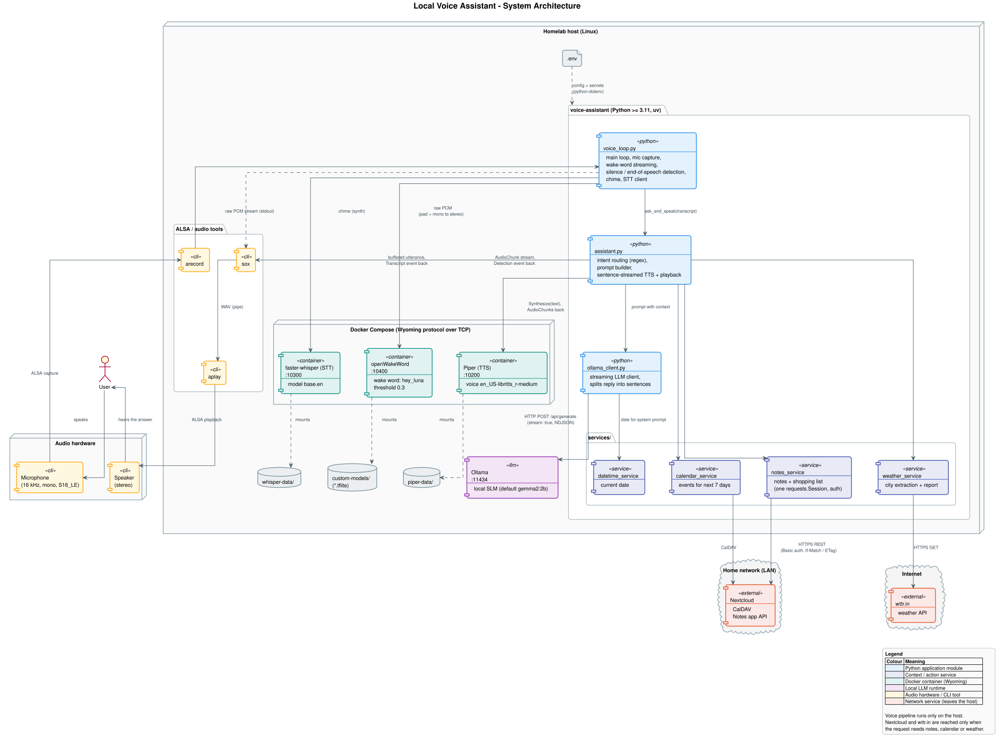
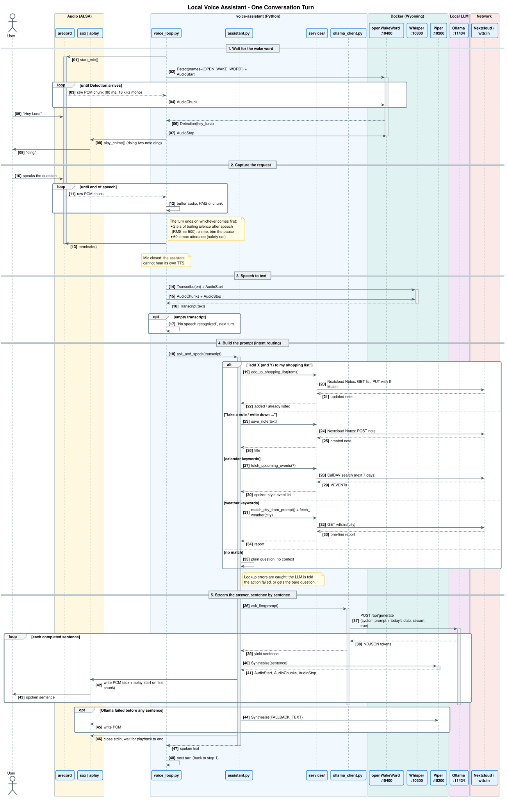

# local-voice-assistant

A local, LLM-powered voice assistant. You speak a wake word, ask a question, and
it answers out loud, running a local SLM (via [Ollama](https://ollama.com/))
as the brain, with local speech-to-text and text-to-speech. It can pull in your
calendar and the weather as context when the question calls for it.

## How it works

```
mic ──▶ openWakeWord ──▶ Whisper (STT) ──▶ prompt builder ──▶ Ollama (LLM) ──▶ Piper (TTS) ──▶ speaker
```

| Stage | Component | Runs |
|-------|-----------|------|
| Wake word | [openWakeWord](https://github.com/dscripka/openWakeWord) via Wyoming | local (Docker) |
| STT | [Whisper](https://github.com/rhasspy/wyoming-faster-whisper) via Wyoming | local (Docker) |
| Language model | [Ollama](https://ollama.com/) (`gemma2:2b` by default) | local |
| TTS | [Piper](https://github.com/rhasspy/wyoming-piper) via Wyoming | local (Docker) |
| Calendar context | CalDAV (e.g. Nextcloud) | network - your server |
| Notes & shopping list | [Nextcloud Notes](https://github.com/nextcloud/notes) API | network - your server |
| Weather context | [wttr.in](https://wttr.in) | network - external |

The voice pipeline is fully local. The network lookups are optional and only
run when the request needs them: taking a note, adding to the shopping list,
or asking about your calendar or the weather.

## Architecture



### One conversation turn



The diagram sources are in [`docs/architecture/`](docs/architecture/) (PlantUML).
After editing a `.puml` file, re-render the SVGs:

```bash
plantuml -tsvg docs/architecture/*.puml
```

## Requirements

- Python 3.11+
- [Ollama](https://ollama.com/) running locally with a model pulled (`ollama pull gemma2:2b`)
- `sox`, `alsa-utils` (`arecord` / `aplay`)
- Docker (for the wake-word, Whisper and Piper services)
- A microphone and speaker

## Setup

```bash
git clone <this-repo>

cd local-voice-assistant

cp .env.example .env   # then set the values

docker compose up -d   # starts openWakeWord, Whisper and Piper services
```

## Usage

Run the voice loop:

```bash
uv sync
uv run voice_loop.py
```
Say the wake word (set by `OPEN_WAKE_WORD`, e.g. `hey_luna`) and wait for the chime.
Then ask your question and pause: after about 2.5 seconds of silence a second chime
confirms the assistant heard you, and it answers out loud. A request is cut off
after 60 seconds at most.


## Wake words

Custom openWakeWord models go in `custom-models/` as `.tflite` files and
are loaded by the openwakeword container on start. The model name is the
filename without the extension (`hey_luna.tflite` is `hey_luna`).

`hey_luna.tflite` is committed here. More community-trained models are available at: 
[fwartner/home-assistant-wakewords-collection](https://github.com/fwartner/home-assistant-wakewords-collection).